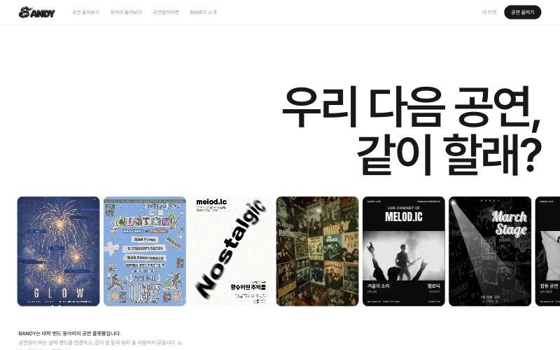
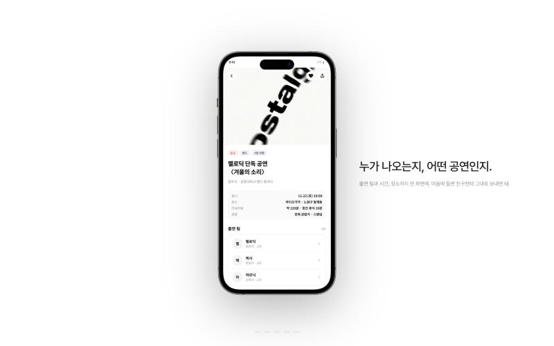
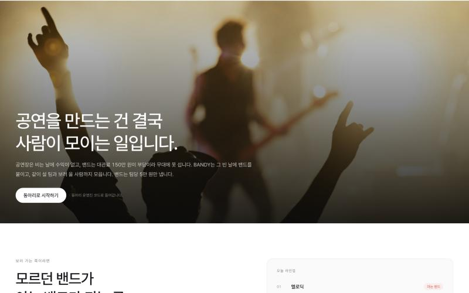
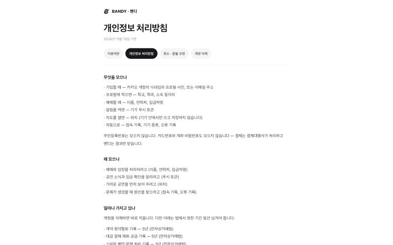
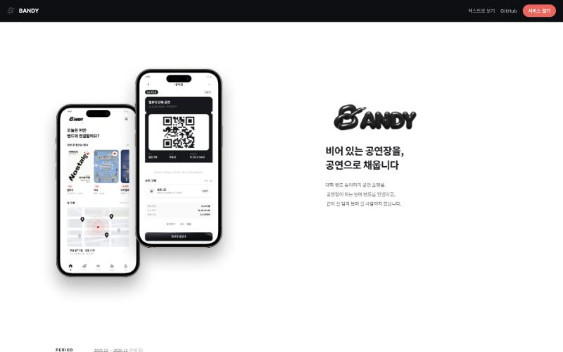
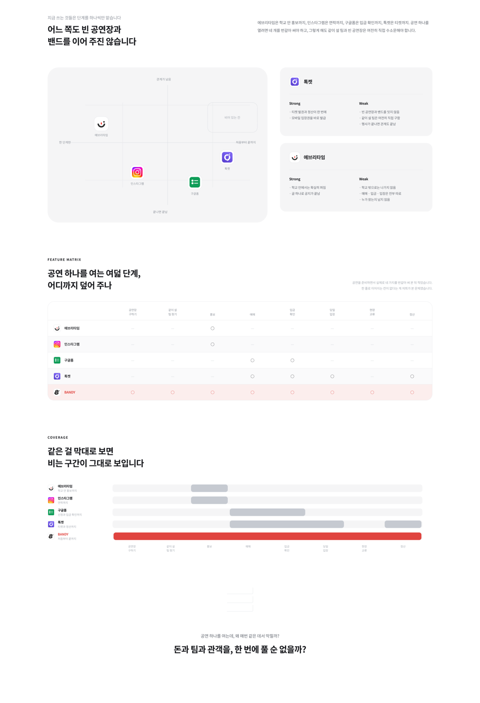
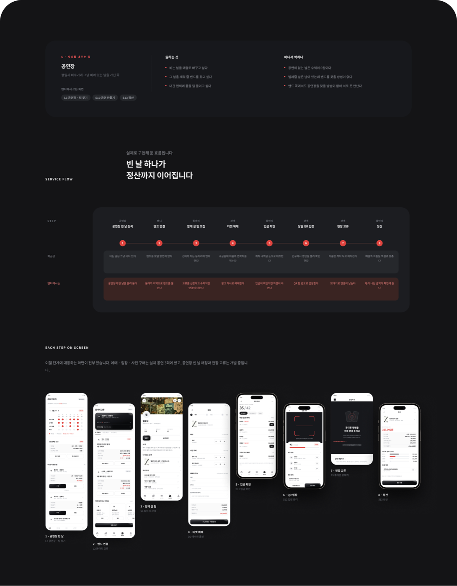

# 밴디 (BANDY)

**공연장이 비는 날에 밴드를 연결합니다. 같이 설 팀과 보러 올 사람까지.**
대학 밴드 동아리의 공연 플랫폼. 노원 대학가에서 시작합니다.

| | |
|---|---|
| **서비스** | <https://www.hibandy.com> |
| **UX 소개서** | <https://dlwldn4824.github.io/bandy-case-study/> |
| **디자인** | [Figma](https://www.figma.com/design/mLwN6nNV8jjSE70CiWRhvs) — 라이트 37화면 · 다크 34화면 |

---

## 만든 것 ①  랜딩 — `/brand`



처음 온 사람이 보는 화면입니다. 히어로에 깔린 열두 장은 **우리가 실제로 올렸던 공연 포스터**입니다. 공연마다 생김새가 달라서, 설명 문구보다 이 띠 하나가 "대학 밴드 공연이 이런 거구나" 를 먼저 말해 줍니다.



가운데 폰은 고정해 두고 **화면만 넘어갑니다.** 스크롤에 따라 홈 → 공연 상세 → 티켓 → 교류 → 기록 순으로 바뀌고, 옆 문구가 그 화면이 무엇인지 한 줄로 받습니다. 캡션을 읽지 않아도 손가락으로 따라가집니다.



읽는 쪽이 셋이라(동아리 · 관객 · 공연장) 섹션도 셋으로 나뉩니다. 각자 자기 문단에서 **자기 입장으로 들어가는 버튼**을 만납니다.

크롤러를 위해 핵심 문구는 정적 HTML로 `#root` 안에 심어 뒀습니다 — 네이버를 비롯한 상당수 크롤러가 자바스크립트를 안 돌려서, 그 전까지 이 사이트는 **빈 페이지**였습니다.

## 만든 것 ②  앱 — `/ui`


왼쪽부터 **홈 · 티켓 QR · 정산 · 동아리 연결 지도.**

- **홈** — 포스터를 줄이지 않습니다. 목록이 한 덩어리로 안 보이게 하려는 것입니다. 아래는 반경 3km 지도.
- **티켓** — 앱을 깔지 않아도 링크로 열립니다. 입금이 확인되면 운영진 손을 거치지 않고 상태가 바뀝니다. 2매를 샀으면 QR 한 번으로 둘 다 처리됩니다.
- **정산** — 빼는 항목(수수료 · 공연장 몫 · 참가비)을 다 보여 주고, 같은 금액을 막대로 한 번 더 보여 줍니다. 나중에 다시 묻지 않게 하려는 것입니다.
- **연결 지도** — 선의 굵기가 함께한 횟수입니다. 점수나 온도가 아니라 **실제로 있었던 일만** 셉니다.

## 만든 것 ③  약관 페이지 — 앱 없이도 열립니다



`/privacy` · `/terms` · `/refund` · `/account-deletion`. 구글 플레이가 **앱을 깔지 않고도** 열 수 있는 개인정보처리방침 주소와 계정 삭제 요청 주소를 요구해서 만들었습니다.

같은 글을 앱과 웹에 두 벌로 두면 반드시 갈라지므로, 앱 화면이 쓰는 `src/new/lightui/legal/content.ts` 를 빌드할 때 그대로 읽어서 찍습니다. **약관을 고치면 웹 페이지가 따라옵니다.**

## 만든 것 ④  UX 소개서



<https://dlwldn4824.github.io/bandy-case-study/> — 문제 정의부터 서비스 플로우, 브랜드, 화면까지 28개 섹션. 피그마 디자인을 HTML로 다시 옮기지 않고 그대로 올렸습니다. 옮기는 순간 피그마와 웹이 갈라져서 둘 다 관리해야 하기 때문입니다.

---

# UX 리서치

**설문을 설계해 돌린 적은 없습니다.** 3년 동안 밴드 동아리를 운영하며 정기공연을 기획했고, 공연장 제휴도 직접 다녔습니다. 아래는 그 과정에서 들은 말입니다. 그래서 **응답 수와 비율은 적지 않습니다** — 세어 본 적 없는 값을 적으면 그때부터 자료 전체를 못 믿게 됩니다.

## ① 경쟁 — 단계를 하나씩만 맡는다



공연을 준비하면서 **네 가지를 실제로 번갈아 써 본 뒤** 적었습니다.

| | 공연장 구하기 | 같이 설 팀 | 홍보 | 예매 | 입금 확인 | 당일 입장 | 현장 교류 | 정산 |
|---|:-:|:-:|:-:|:-:|:-:|:-:|:-:|:-:|
| 에브리타임 | — | — | ○ | — | — | — | — | — |
| 인스타그램 | — | — | ○ | — | — | — | — | — |
| 구글폼 | — | — | — | ○ | ○ | — | — | — |
| 톡켓 | — | — | — | ○ | ○ | ○ | — | ○ |
| **BANDY** | ○ | ○ | ○ | ○ | ○ | ○ | ○ | ○ |

위 사분면에서 **오른쪽 위가 비어 있습니다.** 처음부터 끝까지 가면서 관계도 남기는 자리를 아무도 안 맡고 있습니다. 특히 왼쪽 두 칸 — 공연장 구하기와 같이 설 팀 찾기 — 은 **제일 먼저 막히는 곳인데 덮는 곳이 하나도 없습니다.**

## ② 당사자에게 들은 말


| 질문 | 돌아온 말 |
|---|---|
| 공연에 왜 왔나요? | 친구가 무대에 서서 · 같이 가자고 해서 — **공연 자체를 보러 왔다는 답은 드물었습니다** |
| 공연에 왜 안 가나요? | 아는 사람이 없어서 · 하는 줄 몰랐어요 · 끝나고 할 게 없어서 |
| 같이 설 팀은 어떻게 구하나요? | 선배가 아는 동아리에 연락 · 작년에 같이 섰던 팀 |
| 입금은 어떻게 확인하나요? | 구글폼을 받고 계좌 내역과 눈으로 대조 · 엑셀에 한 줄씩 옮겨 적음 |

> **밴드 동아리 회장** — 돈을 먼저 내는 게 제일 무서워요. 표가 안 팔리면 그대로 적자니까요. 대관료 150만 원을 네다섯 팀이 나눠도 한 팀에 30만 원이 넘습니다.

> **공연장 운영자** — 빌려줄 날은 남아 있는데, 그 날을 채워 줄 밴드를 찾을 방법이 없어요. 공연이 없는 날은 수익이 0원입니다.

> **공연을 보러 다니는 관객** — 네 팀이 나왔는데 모르던 세 팀이 더 좋았어요. 그 이름을 적어 뒀는데 그걸로 끝이었습니다.

## ③ 어피니티 — 다섯 덩어리, 그대로 기능으로


| 덩어리 | 대표적인 말 | 무엇으로 만들었나 |
|---|---|---|
| **돈** | 대관료를 공연 전에 선결제한다 | 공연장 빈 날 + 참가비 5만 원 (`L3` · `S10`) |
| **같이 설 팀** | 아는 선에서만 팀을 구한다 | 분야 · 지역으로 찾는 동아리 교류 (`L2` · `S4`) |
| **관객** | 아는 사람이 있어야 간다 | 포스터 홈 · 반경 3km 지도 (`L1` · `S2`) |
| **공연장의 빈 날** | 공연이 없는 날 수익이 0원이다 | 빈 날 등록 → 밴드 매칭 (`L3`) |
| **공연이 끝난 뒤** | 함께 선 팀과 연락이 끊긴다 | 교류 기록이 선으로 쌓이는 연결 지도 (`C1`~`C4`) |

## ④ 그래서 — 빈 날 하나가 정산까지



여덟 단계에 **대응하는 화면이 전부 있습니다.** 예매 · 입장 · 사전 구매는 실제 공연 3회에 썼고, 공연장 빈 날 매칭과 현장 교류는 개발 중입니다.

가상의 페르소나를 세우는 대신 당사자별로 정리했는데, 만들다 보니 하나가 더 갈라졌습니다 — **동아리 안에서도 운영진과 부원이 할 수 있는 일이 완전히 다릅니다.** 한 입구로 받으면 부원에게 「공연 만들기」가 먼저 보입니다. 그래서 가입 입장은 **운영진 · 부원 · 관객 · 공연장** 넷입니다.

---

# 코드

## 화면과 경로

| | 경로 |
|---|---|
| 랜딩 | `/brand` |
| 가입 | `/ui/join` → `/ui/start` → `/ui/start/profile` |
| 관객 | `/ui` · `/ui/map` · `/ui/show/:id` · `/ui/tickets` |
| 예매 | `/ui/show/:id/book` → `/deposit` → `/ui/ticket/:id` |
| 공연 당일 | `/ui/live/:id` 아래 |
| 동아리 | `/ui/clubs` · `/ui/club/:id` · `/ui/connections` |
| 운영진 | `/ui/console` · `/ui/show/:id/run` · `/ui/deposits` · `/ui/entry` · `/ui/settlement` |
| 약관 | `/ui/legal/:doc` · `/privacy` · `/terms` · `/refund` · `/account-deletion` |

경로 상수는 [`src/new/lightui/paths.ts`](./src/new/lightui/paths.ts) 한 곳에 있습니다.

## 폴더

```
src/
  new/           지금 서비스
    lightui/       앱 화면 (/ui/*)
    brand/         랜딩 (/brand)
    mocks/         화면이 쓰는 목 데이터
  old/           2025 공연 앱 (/old/*)
  shared/        양쪽이 쓰는 것 (config · assets · styles)
  _unused/       아무 데서도 안 쓰는 코드 (빌드에서 제외)
docs/            store · backend · setup · screenshots
scripts/         빌드 보조 (약관 페이지 생성 · 경로 점검)
public/          그대로 서빙 (robots · sitemap · OG · 서비스 워커)
api/  server/    서버 API
```

**`new` 는 `old` 에 기대지 않습니다.** `new` 가 밖에서 쓰는 것은 `shared/config/firebase` 하나뿐이라, 옛 앱을 통째로 들어내도 지금 서비스는 그대로 돕니다.

## 시작하기

```bash
npm install
```

```bash
npm run dev
```

```bash
npm run build
```

```bash
npm run check:routes
```

마지막 것은 배포된 주소가 실제로 열리는지 훑습니다. SPA 는 어떤 주소든 `index.html` 을 돌려줘서 상태 코드만으로는 알 수 없으므로, 그 페이지에 있어야 할 문구까지 같이 봅니다.

환경 변수는 [`.env.example`](./.env.example) 을 복사해 쓰세요. 전부 비워 둬도 앱은 돕니다 — 카카오 로그인은 목으로, 카드 결제는 버튼이 숨고, 푸시는 「준비 중」 으로 뜹니다.

## 문서

| | |
|---|---|
| [출시-준비.md](./docs/store/출시-준비.md) | 순서 · 비용 · 사업자등록을 미뤄야 하는 이유 |
| [스토어-심사-반려-예상.md](./docs/store/스토어-심사-반려-예상.md) | 애플 · 구글에서 걸릴 것들 |
| [심사-제출-체크리스트.md](./docs/store/심사-제출-체크리스트.md) | 제출할 때 넣을 값, 아직 안 끝난 것 |
| [development-plan.md](./docs/backend/development-plan.md) · [db-design.md](./docs/backend/db-design.md) · [data-flow.md](./docs/backend/data-flow.md) · [external-apis.md](./docs/backend/external-apis.md) | 백엔드 설계 |
| [2025-공연앱.md](./docs/2025-공연앱.md) | 옛 앱(`/old`)의 기능 · 보안 · 데이터 분석 |

## 기술

React 18 · TypeScript · Vite · React Router · Firebase · Vercel

## 숫자에 대해

확인된 값만 적습니다. 화면에 보이는 금액은 예시 값이고, 공연장 몫의 비율은 공연장마다 협의로 정합니다.

## 라이선스

MIT
