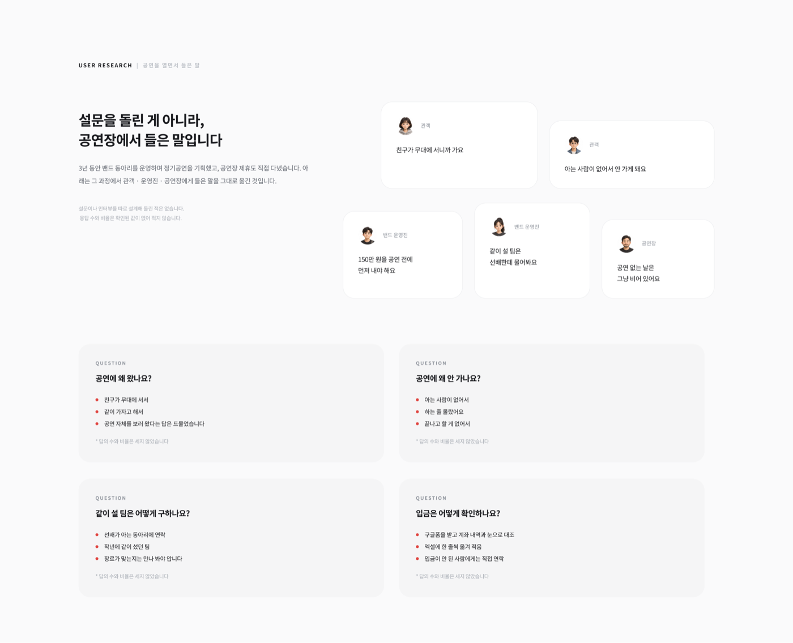
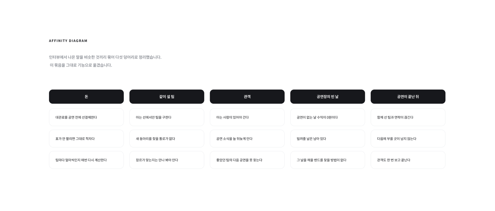

# 밴디 (BANDY)

**공연장이 비는 날에 밴드를 연결합니다. 같이 설 팀과 보러 올 사람까지.**
대학 밴드 동아리의 공연 플랫폼. 노원 대학가에서 시작합니다.


<sub>왼쪽부터 홈 · 티켓 QR · 정산 · 동아리 연결 지도. Figma `앱 · 라이트 UI` 에서 그대로 내려받은 화면입니다.</sub>

| | |
|---|---|
| **서비스** | <https://band-alpha.vercel.app> |
| **UX 소개서** | <https://dlwldn4824.github.io/bandy-case-study/> — 문제 정의부터 서비스 플로우, 브랜드, 화면까지 ([저장소](https://github.com/dlwldn4824/bandy-case-study)) |
| **디자인** | [Figma · 앱 / 웹](https://www.figma.com/design/mLwN6nNV8jjSE70CiWRhvs) — 라이트 UI 37화면 · 다크 UI 34화면 · 프로토타입 연결 |

## 한 공연이 이렇게 이어집니다

```
공연장 빈 날 등록 → 밴드 연결 → 함께 설 팀 모집 → 티켓 예매
   → 입금 확인 → 당일 QR 입장 → 현장 교류 → 정산
```

예매 · 입장 · 사전 구매는 **실제 공연 3회**에 썼습니다. 공연장 빈 날 매칭과 현장 네트워킹은 개발 중입니다.

---

---

## UX 리서치 — 무엇을 어떻게 알아봤나

**설문을 설계해 돌린 적은 없습니다.** 3년 동안 밴드 동아리를 운영하며 정기공연을 기획했고, 공연장 제휴도 직접 다녔습니다. 아래는 그 과정에서 관객 · 운영진 · 공연장에게 들은 말을 옮긴 것입니다. 그래서 **응답 수와 비율은 적지 않습니다** — 세어 본 적이 없는 값을 적으면 그때부터 전부 못 믿을 자료가 됩니다.

전체는 [UX 소개서](https://dlwldn4824.github.io/bandy-case-study/)에 있습니다.

### 1. 책상 조사 — 돈이 먼저 나간다

공연장 하나를 빌리는 데 **150만 원**, 그것도 공연 전에 먼저 냅니다. 혼자 못 내니 네다섯 팀을 모아 나누는데 그래도 **한 팀에 30만 원이 넘습니다.** 그렇게 돈을 내고 열어도 객석은 다시 아는 사람으로 찹니다.

해외에는 행사를 열고 티켓을 팔고 사람을 모으는 큰 플랫폼이 이미 있습니다 (이벤트브라이트 한 해 거래액 30억 달러 · 행사 460만 개). 국내에는 같은 자리를 맡은 곳이 아직 없고, 작년 국내 행사 중 오프라인 비중은 73.9%로 오르고 있습니다.

### 2. 경쟁 — 지금 쓰는 것들은 단계를 하나씩만 맡는다


공연을 준비하면서 **네 가지를 실제로 번갈아 써 본 뒤** 적었습니다.

| | 공연장 구하기 | 같이 설 팀 | 홍보 | 예매 | 입금 확인 | 당일 입장 | 현장 교류 | 정산 |
|---|:-:|:-:|:-:|:-:|:-:|:-:|:-:|:-:|
| 에브리타임 | — | — | ○ | — | — | — | — | — |
| 인스타그램 | — | — | ○ | — | — | — | — | — |
| 구글폼 | — | — | — | ○ | ○ | — | — | — |
| 톡켓 | — | — | — | ○ | ○ | ○ | — | ○ |
| **BANDY** | ○ | ○ | ○ | ○ | ○ | ○ | ○ | ○ |

왼쪽 두 칸 — **공연장 구하기와 같이 설 팀 찾기** — 을 덮는 곳이 하나도 없습니다. 거기가 제일 먼저 막히는 곳인데 아무도 안 맡고 있습니다.

### 3. 당사자에게 들은 말



네 가지를 물었습니다.

| 질문 | 돌아온 말 |
|---|---|
| 공연에 왜 왔나요? | 친구가 무대에 서서 · 같이 가자고 해서 — **공연 자체를 보러 왔다는 답은 드물었습니다** |
| 공연에 왜 안 가나요? | 아는 사람이 없어서 · 하는 줄 몰랐어요 · 끝나고 할 게 없어서 |
| 같이 설 팀은 어떻게 구하나요? | 선배가 아는 동아리에 연락 · 작년에 같이 섰던 팀 — **장르가 맞는지는 만나 봐야 압니다** |
| 입금은 어떻게 확인하나요? | 구글폼을 받고 계좌 내역과 눈으로 대조 · 엑셀에 한 줄씩 옮겨 적음 |

운영진과 공연장에게는 질문을 최소한으로 하고 겪은 일을 자유롭게 말해 달라고 했습니다.

> **밴드 동아리 회장** — 돈을 먼저 내는 게 제일 무서워요. 표가 안 팔리면 그대로 적자니까요. 공연 하나 열면 두 달이 날아가요.

> **공연장 운영자** — 빌려줄 날은 남아 있는데, 그 날을 채워 줄 밴드를 찾을 방법이 없어요.

> **공연을 보러 다니는 관객** — 네 팀이 나왔는데 모르던 세 팀이 더 좋았어요. 그 이름을 적어 뒀는데 그걸로 끝이었습니다.

### 4. 어피니티 — 다섯 덩어리로 묶었다



나온 말을 비슷한 것끼리 묶으니 다섯 덩어리였습니다. **이 묶음을 그대로 기능으로 옮겼습니다.**

| 덩어리 | 대표적인 말 | 무엇으로 만들었나 |
|---|---|---|
| **돈** | 대관료를 공연 전에 선결제한다 | 공연장 빈 날 + 참가비 5만 원 (`L3` · `S10`) |
| **같이 설 팀** | 아는 선에서만 팀을 구한다 | 분야 · 지역으로 찾는 동아리 교류 (`L2` · `S4`) |
| **관객** | 아는 사람이 있어야 간다 | 포스터 홈 · 반경 3km 지도 (`L1` · `S2`) |
| **공연장의 빈 날** | 공연이 없는 날 수익이 0원이다 | 빈 날 등록 → 밴드 매칭 (`L3`) |
| **공연이 끝난 뒤** | 함께 선 팀과 연락이 끊긴다 | 교류 기록이 선으로 쌓이는 연결 지도 (`C1`~`C4`) |

### 5. 당사자는 셋인데, 입장은 넷이다

가상의 페르소나를 세우는 대신 **당사자별로 무엇을 원하고 어디서 막히는지**로 정리했습니다. 막히는 지점은 공연을 열면서 실제로 겪은 것들입니다.

| | 원하는 것 | 어디서 막히나 |
|---|---|---|
| **동아리 운영진** | 목돈 없이 공연을 열고, 아는 선 밖에서 팀을 찾고 싶다 | 대관료 선결제 · 선배 인맥이 전부 · 입금을 눈으로 대조 |
| **관객** | 아는 사람이 없어도 갈 만한 공연을 찾고 싶다 | 인스타 스토리를 놓치면 없었던 일 · 좋았던 팀의 다음을 못 찾음 |
| **공연장** | 비는 날을 매출로 바꾸고 싶다 | 그 날을 채울 밴드를 찾을 방법이 없다 |

실제로 가입을 만들 때는 여기서 하나가 더 갈라졌습니다 — **동아리 안에서도 운영진과 부원이 할 수 있는 일이 완전히 다릅니다.** 운영진은 공연을 올리고 돈을 다루고, 부원은 자기 순서와 공지를 봅니다. 한 입구로 받으면 부원에게 「공연 만들기」가 먼저 보입니다. 그래서 가입 입장은 **운영진 · 부원 · 관객 · 공연장** 넷입니다.


## 지금 쓰는 화면

처음 온 사람은 `/` 로 들어와 `/brand` 랜딩을 보고, 가입하면 `/ui` 아래 앱으로 들어갑니다.
가입은 네 입장으로 갈립니다 — **동아리 운영진 · 동아리 부원 · 관객 · 공연장.** 받는 것도 끝나고 가는 곳도 다릅니다.

| | 경로 | |
|---|---|---|
| **랜딩** | `/brand` | 처음 온 사람에게 보여 주는 페이지 |
| **가입** | `/ui/join` → `/ui/start` → `/ui/start/profile` | 입장 고르기 → 로그인(카카오 · 이메일) → 온보딩 |
| **관객** | `/ui` · `/ui/map` · `/ui/show/:id` · `/ui/tickets` | 홈 · 지도 · 공연 상세 · 내 티켓 |
| **예매** | `/ui/show/:id/book` → `/deposit` → `/ui/ticket/:id` | 매수 → 입금(계좌이체 · 카드) → QR 티켓 |
| **공연 당일** | `/ui/live/:id` 아래 | 셋리스트 · 사전 구매 교환 · 현장 교류 · 방명록 |
| **동아리** | `/ui/clubs` · `/ui/club/:id` · `/ui/connections` | 교류 · 동아리 상세 · 연결 지도 |
| **운영진** | `/ui/console` · `/ui/show/:id/run` · `/ui/deposits` · `/ui/entry` · `/ui/settlement` | 공연 관리 · 당일 타임라인 · 입금 · 입장 · 정산 |
| **약관** | `/ui/legal/:doc` · `/privacy` · `/terms` · `/refund` · `/account-deletion` | 앱 안과 웹 양쪽에서 열립니다 |

경로 상수는 [`src/lightui/paths.ts`](./src/new/lightui/paths.ts) 한 곳에 있습니다. Figma 프로토타입 연결을 그대로 옮긴 것이라 화면에서 어디로 가는지가 1:1 입니다.

## 폴더

```
src/
  new/           지금 서비스
    lightui/       앱 화면 (/ui/*)
      screens/       L1 홈, D2 예매, S19 공연 당일 …
      components/    Phone, TopBar, Sheet, Button …
      legal/         약관 · 개인정보 · 환불 본문 (웹 페이지도 여기서 찍습니다)
      pay/           포트원 결제 (테스트 모드)
      push/          웹 푸시
      safety/        신고 · 차단
    brand/         랜딩 (/brand)
    mocks/         화면이 쓰는 목 데이터
  old/           2025 공연 앱 (/old/*) — docs/2025-공연앱.md
  shared/        양쪽이 같이 쓰는 것
    config/        Firebase · 브랜드명
    assets/        이미지 · 폰트
    styles/        전역 토큰
  _unused/       아무 데서도 안 쓰는 코드 (빌드에서 제외)
  main.tsx  App.tsx  index.css
```

```
docs/
  store/      스토어 출시 · 심사
  backend/    백엔드 설계
  setup/      Firebase · 메일 · 시트 연동 설정
  bizplan/    사업 계획
  screenshots/
scripts/      빌드 보조 (약관 페이지 생성 등)
public/       그대로 서빙되는 것 (robots · sitemap · OG 이미지 · 서비스 워커)
api/  server/ 서버 API
```

**`new` 는 `old` 에 기대지 않습니다.** `new` 가 밖에서 가져다 쓰는 것은 `shared/config/firebase` 하나뿐입니다. 옛 앱을 통째로 들어내도 지금 서비스는 그대로 돕니다.

브랜드명은 [`src/shared/config/brand.ts`](./src/shared/config/brand.ts) 한 곳에서만 바꿉니다 — 한때 '마주'로 바꿨다가 되돌린 적이 있어서 그렇게 모아 뒀습니다. 코드 안의 식별자(`bandyCore.js`, `Bandy.css` 등)는 그대로 둡니다.

## 시작하기

```bash
npm install
```

```bash
npm run dev
```

```bash
npm run build
```

`npm run build` 는 빌드 전에 [`scripts/build-legal-pages.mjs`](./scripts/build-legal-pages.mjs) 를 돌려 약관 · 개인정보 · 환불 · 계정 삭제를 정적 HTML 로 찍습니다. 앱 안 약관을 고치면 웹 페이지가 따라옵니다.

```bash
npm run check:routes
```

배포된 주소가 실제로 열리는지 훑습니다. SPA 는 어떤 주소든 index.html 을 돌려줘서 상태 코드만으로는 알 수 없으므로, 그 페이지에 있어야 할 문구까지 같이 봅니다 (`cleanUrls` 를 켰다가 `/brand` 와 `/ui` 가 통째로 404 가 된 적이 있어 만들었습니다).

환경 변수는 [`.env.example`](./.env.example) 을 복사해 쓰세요. 전부 비워 둬도 앱은 돕니다 — 카카오 로그인은 목으로, 카드 결제는 버튼이 숨고, 푸시는 「준비 중」 으로 뜹니다.

## 문서

| | |
|---|---|
| [출시-준비.md](./docs/store/출시-준비.md) | 순서 · 비용 · 사업자등록을 미뤄야 하는 이유 |
| [스토어-심사-반려-예상.md](./docs/store/스토어-심사-반려-예상.md) | 애플 · 구글에서 걸릴 것들 |
| [심사-제출-체크리스트.md](./docs/store/심사-제출-체크리스트.md) | 제출할 때 넣을 값, 아직 안 끝난 것 |
| [2025-공연앱.md](./docs/2025-공연앱.md) | 옛 앱(`/old`)의 기능 · 보안 · 데이터 분석 |
| [landing-copy.md](./docs/landing-copy.md) | 랜딩 문구 |
| [development-plan.md](./docs/backend/development-plan.md) | 백엔드 개발 계획 |
| [db-design.md](./docs/backend/db-design.md) · [db-structure.xlsx](./docs/backend/db-structure.xlsx) | DB 구조 |
| [data-flow.md](./docs/backend/data-flow.md) | 데이터 흐름 |
| [external-apis.md](./docs/backend/external-apis.md) · [backend-api-spec.xlsx](./docs/backend/backend-api-spec.xlsx) | API 명세 |

## 기술

React 18 · TypeScript · Vite · React Router · Firebase (Firestore · Storage) · Vercel

## 숫자에 대해

확인된 값만 적습니다. 설문이나 인터뷰를 설계해 돌린 적이 없어서 응답 수와 비율은 넣지 않았고,
화면에 보이는 금액은 예시 값입니다. 공연장 몫의 비율은 공연장마다 협의로 정합니다.

## 라이선스

MIT
